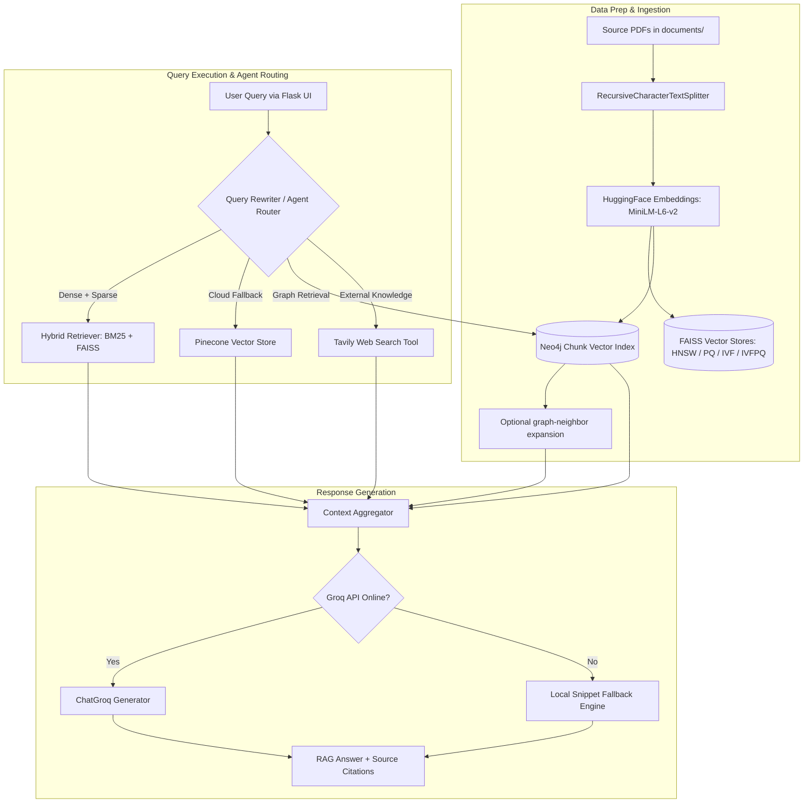

<div align="center">

# Google 5 Days VibeCodes
### *The Ultimate 0-to-100% RAG Mastery & Production Agentic AI Teaching Assistant*


<p align="center">
  <a href="#tech-stack--skills-ecosystem"><b>Tech Stack</b></a> •
  <a href="#architecture--pipeline"><b>Architecture</b></a> •
  <a href="#rag-learning-roadmap-0-to-100"><b>RAG Roadmap</b></a> •
  <a href="#index-type-cheatsheet"><b>FAISS Comparison</b></a> •
  <a href="#quick-start"><b>Quick Start</b></a> •
  <a href="#project-structure"><b>Project Structure</b></a>
</p>

---

</div>

## Overview & Vision

**Google 5 Days VibeCodes** is a research-grade, production-aware AI Teaching Assistant framework built to transition learners from **RAG beginners** to **Deep RAG & Agentic AI Practitioners**.

This repo serves a dual purpose:
1. **Live Code & Learning Lab**: Interactive notebooks and modular backends detailing step-by-step vector search mechanics, query rewriting, hybrid retrieval, and agent tool calling.
2. **Production Blueprint**: Dual Flask backends demonstrating local document ingestion, vector quantization, API failure resilience, and observability via **LangSmith**.

---

## Tech Stack & Skills Ecosystem

<div align="center">

| Domain | Technologies & Frameworks |
| :--- | :--- |
| **Backend & Web** |   |
| **Orchestration** |  |
| **Retrieval & Data Stores** |    |
| **LLM Inference** |  |
| **Embeddings** |  |
| **Search & Web AI** |  |
| **Observability** |  |

</div>

---

## Architecture & Pipeline



---

## RAG Learning Roadmap (0 to 100%)

This project grows daily as we learn and implement deeper RAG paradigms:

* [x] **Level 1: Fundamentals (Naive RAG)**
* Local PDF ingestion & chunking using `RecursiveCharacterTextSplitter`.
* Sentence transformer vector embeddings (`all-MiniLM-L6-v2`).


* [x] **Level 2: Vector Indexing & Optimization**
* High-performance vector indexing with **FAISS** (`HNSW`, `PQ`, `IVF`, `IVFPQ`).
* Pre-computed index storage & loading strategies.


* [x] **Level 3: Hybrid Retrieval & Multi-Querying**
* Combining sparse keyword search (**BM25**) with dense semantic search (**FAISS**).
* Query rewriting pipelines to fix ambiguous user inputs.


* [x] **Level 4: Graph RAG**
* Neo4j vector retrieval over embedded chunks.
* Optional expansion with directly connected graph nodes and relationships.


* [x] **Level 5: Agentic RAG & Cloud Integration**
* Agent tool selection with **Tavily Web Search** for real-time external knowledge.
* Integration with **Pinecone Vector Store** for cloud-scale retrieval.


* [x] **Level 6: Observability & Production Hardening**
* End-to-end tracing with **LangSmith**.
* Local fallback mechanisms when external APIs (Groq/Pinecone) fail.
* Multi-backend architecture (`app.py` vs `app_new.py`).


---

## Index Type Cheatsheet

Understanding vector indexing is crucial for production RAG scale:

| Index Type | Full Name | Search Speed | Memory Usage | Precision (Recall) | Best Use Case |
| --- | --- | --- | --- | --- | --- |
| **HNSW** | Hierarchical Navigable Small World | High | High | 95%+ | Best query speed & high accuracy |
| **PQ** | Product Quantization | Medium | Very Low | 80-85% | Memory-constrained server environments |
| **IVF** | Inverted File Index | High | Medium | 85-90% | Large datasets requiring fast partitioning |
| **IVFPQ** | IVF + Product Quantization | Very High | Extremely Low | 75-85% | Ultra large-scale low-RAM deployment |

---

## Project Structure

```text
├── documents/                 # PDF source documents for indexing
├── HNSW_faiss/                # Pre-built FAISS index (HNSW graph)
├── PQ_faiss/                  # Pre-built FAISS index (Product Quantized)
├── IVF_faiss/                 # Pre-built FAISS index (Inverted File)
├── IVFPQ_faiss/               # Pre-built FAISS index (Combined IVF-PQ)
├── GRAPH RAG/                 # Graph extraction artifact used in the Neo4j learning workflow
├── Knowledge Graph .ipynb     # Neo4j chunk ingestion and vector-index walkthrough
├── graph_rag.py               # Shared Neo4j vector and graph-neighbor retrieval
├── templates/                 # Frontend UI templates
│   └── index.html             # Clean browser-based chat web app
├── app.py                     # Feature-rich backend (Agents, Tavily, Pinecone, Hybrid)
├── app_new.py                 # Stable production backend (FAISS index switcher & Groq)
├── Learn RAG step by step.ipynb # Step-by-step master notebook
├── HNSW.ipynb                 # HNSW vector indexing exploration
├── PQ.ipynb                   # Product Quantization experimentation
├── api_test.ipynb             # API connectivity & Pinecone integration tests
├── .env                       # API keys & environment secrets (Git-ignored)
└── README.md                  # Project documentation

```

---

## Quick Start

### 1. Clone & Set Up Environment

```powershell
# Navigate to project directory
cd "Google-5-Days-AgenticAI-VibeCoding"

# Create virtual environment
python -m venv .venv

# Activate environment (Windows PowerShell)
.venv\Scripts\activate

```

### 2. Install Dependencies

```powershell
pip install flask python-dotenv langchain-core langchain-groq langchain-classic langchain-community langchain-text-splitters requests langsmith pinecone-client neo4j sentence-transformers

```

### 3. Environment Variables Setup

Create a `.env` file in the root folder:

```env
GROQ_API_KEY=your_groq_api_key
PINECONE_API_KEY=your_pinecone_api_key
TAVILY_API_KEY=your_tavily_api_key
LANGSMITH_API_KEY=your_langsmith_api_key
LANGSMITH_TRACING=true
NEO4J_URI=bolt://localhost:7687
NEO4J_USERNAME=neo4j
NEO4J_PASSWORD=your_neo4j_password
NEO4J_DATABASE=neo4j
NEO4J_VECTOR_INDEX=chunk_embedding_index

```

### Graph RAG retrieval

Choose **Neo4j Graph RAG** in the chat retrieval picker. The application embeds the question with the same `all-MiniLM-L6-v2` model used by the Neo4j learning notebook, searches the `chunk_embedding_index` vector index, and passes matching chunk text to the answer model. If matching chunks have graph relationships, their directly connected nodes and relationship types are added as extra context. The response also includes the retrieved Neo4j chunks as sources, with similarity scores.

**Concept:** ordinary vector RAG finds text passages that are semantically similar to a question. Graph RAG can extend those matches by following explicit links between entities, concepts, and passages, helping answer questions that depend on relationships rather than one passage alone. This implementation uses Neo4j vector search to find starting chunks, then optionally adds their directly connected nodes and relationship types to the answer context.

Before using this option:

1. Start a Neo4j database that supports vector indexes and set the connection variables shown above in `.env`.
2. Run the ingestion and vector-index setup cells in [Knowledge Graph .ipynb](./Knowledge%20Graph%20.ipynb). The configured index must contain `Chunk` nodes with `embedding`, `text`, and optionally `topic` properties. Set `NEO4J_VECTOR_INDEX` if you use a different index name.
3. Install the Python Neo4j driver (`neo4j`, included in the install command above) and start either Flask backend.

The current notebook creates and vector-indexes `Chunk` nodes; it does not create semantic relationships between chunks. Graph-neighbor expansion is therefore optional and only adds extra context when relationships exist in the database. To get richer Graph RAG behavior, ingest entity nodes and explicit relationships as well. Neo4j configuration or query errors are returned to the chat rather than silently switching to a different index.

### 4. Run the Application

Select your backend entry point:

**Stable & Lightweight Mode:**

```powershell
python app_new.py

```

**Experimental Agentic RAG Mode:**

```powershell
python app.py

```

Open your browser and navigate to: `http://127.0.0.1:5000/`

---

## Production Readiness Checklist

* [x] **Graceful Degradation**: Fallback to local snippet extraction when external LLM endpoints are unresponsive.
* [x] **Index Pre-Computation**: Decoupled heavy FAISS indexing from runtime user web requests.
* [x] **Observability**: Complete tracing with LangSmith to debug retrieval latency and agent steps.
* [ ] **Dockerization**: Containerize application with dedicated build steps for vector databases.
* [ ] **Dependency Pinning**: Freeze dependencies in a `requirements.txt` file for reproducible builds.

---

## Ongoing Contributions & Roadmap

Since this is an active ongoing project, future updates will include:

* [ ] Parent-Child / Multi-Vector Chunking strategies.
* [ ] Build and evaluate a richer entity-and-relationship knowledge graph for Graph RAG.
* [ ] Self-RAG & Corrective RAG (CRAG) feedback loops.
* [ ] Semantic Caching layer to eliminate redundant LLM calls.
* [ ] Full Docker & Docker-Compose setup for 1-click deployment.

---

*Crafted during the Google 5 Days Agentic AI & Vibe Coding Challenge.*
